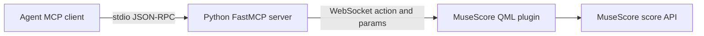
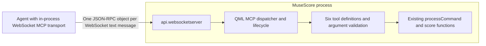

# Direct MCP in the MuseScore QML plugin

Technical feasibility report — 2026-10-21. Investigation only; no implementation.

## Finding

**The Python server can plausibly be eliminated if the agent supports a custom WebSocket MCP transport. A replacement that works through ordinary stdio or Streamable HTTP client configuration is blocked by the existing QML API.**

MuseScore already implements the score operations in this repository's QML plugin. The remaining server work is JSON-RPC dispatch, MCP lifecycle handling, tool schemas, argument validation, and result conversion. Those are feasible in QML JavaScript. MuseScore's built-in `api.websocketserver` can deliver complete text messages in both directions without a helper process.

The qualification matters: an agent must connect directly using compatible WebSocket client code inside its own process. A separate WebSocket-to-stdio/HTTP bridge would violate the requirements. The existing README's command-based client configuration cannot simply be pointed at a `ws://` URL.

Recommend a small experiment targeting MCP **2025-11-25**, with an explicitly documented custom WebSocket binding and an agent whose transport can be extended. This revision provides the requested `initialize` handshake. MCP **2026-07-28** has different discovery/version semantics; supporting it is a separate increment, described below.

## Evidence and confidence

The investigation inspected:

- [server.py](server.py), [musescore-mcp-plugin.qml](musescore-mcp-plugin.qml), the README, requirements, and browser test client.
- The adjacent MuseScore checkout at `26fb3eb54d526da1290b36b266c91996029031a4`, including its development WebSocket example. Its framework submodule is not checked out; the relevant public framework files were retrieved separately at the pinned submodule revision `5ac6ccbfd9fe75e2840112a0cf4b3b86163232b9`.
- MuseScore tag `v4.7.5`, commit `3654226c2e99289916916953a98e585a3d3b315a`, using local Git history. This establishes the API behavior for the installed release, independently of current development changes.
- Installed `/Applications/MuseScore 4.app`, version **4.7.5**, bundled Qt **6.10**. The executable contains the WebSocket API classes and the bundle includes QtWebSockets, but no `QtWebSockets` QML import module was found.
- Official MCP and Qt specifications linked alongside the findings below.

This is source and packaging evidence, not a completed runtime demonstration. No plugin was installed, no server started, and no score edited. Compatibility with MuseScore 3 or arbitrary distributions has not been established; the README's broad version claim is insufficient for this design. WebSocket API registration is conditional on the build's `MUSE_MODULE_NETWORK_WEBSOCKET` setting.

An attempt to introspect FastMCP's generated tool schemas in the existing `venv` failed during MCP/Pydantic import (`ContentBlock` resolution, followed by a GraalPy `NameError` attribute error). Thus exact SDK-generated schemas and live response parity remain unverified. Installed metadata says MCP 1.30.0, while `requirements.txt` only specifies a lower bound. The report does not assume a reproducible historical SDK contract.

## Existing behavior to preserve

The current architecture is:

Only six tools are actively registered. Most individually named editing tools in `server.py` are commented out.

| MCP tool | Arguments | Existing implementation / return value |
| --- | --- | --- |
| `connect_to_musescore` | None | Opens the bridge socket; returns `{"success": boolean}`. |
| `ping_musescore` | None | Sends `ping`; normally returns `{"status":"success","result":"pong"}`. |
| `get_score` | None | Sends `getScore`; returns the plugin envelope containing score analysis. |
| `get_score_metadata` | None | Sends `getScoreMetadata`; returns the plugin envelope containing metadata. |
| `get_cursor_info` | None | Sends `getCursorInfo`; returns the plugin envelope containing cursor/selection information. |
| `processSequence` | Required `sequence` array | Sends `processSequence` with the sequence; returns its envelope, selection, and score summary. Preserve capitalization. |

The `ActionSequence` type declares 19 action variants:

| Action variants | Declared parameters |
| --- | --- |
| `getScore`, `getScoreMetadata`, `appendMeasure`, `deleteSelection`, `getCursorInfo`, `nextElement`, `prevElement`, `selectCurrentMeasure`, `insertMeasure`, `goToFinalMeasure`, `goToBeginningOfScore`, `undo`, `nextStaff`, `prevStaff` | Required `params` object with arbitrary values. |
| `goToMeasure` | Required `params.measure` integer. |
| `setTimeSignature` | Required integer `params.numerator` and `params.denominator`. |
| `addNote` | Required `pitch` integer, `duration` dictionary of integer values keyed by numerator/denominator, and `advanceCursorAfterAction` boolean. |
| `addRest` | Required `duration` dictionary and `advanceCursorAfterAction` boolean. |
| `addTuplet` | Required `duration` and `ratio` dictionaries and `advanceCursorAfterAction` boolean. |

Each variant requires `action` and `params`. The dictionary annotations do not by themselves establish that both fraction keys must exist; retain the actual schema and runtime checks rather than inferring a stricter contract. Full preservation requires capturing the generated union schema, coercions, extra-field handling, descriptions, and result serialization from a working, pinned baseline before porting validation.

Important existing semantics in the repository code:

- `processMessage` wraps normal returns in `{status:"success", result:...}` and thrown exceptions in `{status:"error", message:...}`. Python forwards both objects. Do not strip this layer during migration.
- Returned `{error:...}` objects are ordinary data today. They do not automatically become MCP `isError:true`. Maintain this distinction for compatibility; improving domain-error signaling would be a separate behavior change.
- `processSequence` executes sequentially, discards individual return values, and returns an aggregate summary. It does not roll back the entire sequence. A command that returns an error object may be followed by further commands.
- The typed union includes `undo`, but the QML sequence whitelist excludes it. Conversely, the whitelist includes nested `processSequence`, which the typed union does not declare. Record these discrepancies; do not silently expand or repair the action contract while porting.
- Selection is global to the plugin and operations target `curScore`, the current score. Cursor movement, undo boundaries, returned summaries, and current limitations concerning voices should stay in the existing functions.
- The connection tool becomes a compatibility operation returning `{"success":true}` after direct MCP connectivity is established. Its bridge-opening side effect disappears. Transport failure is then reported by the agent's connection attempt; an unreachable server cannot return `{"success":false}`. This lifecycle difference is unavoidable when removing the bridge.

None of the active Python tools uses `music21`; the dependency is listed but not used by `server.py`. No Python music-processing algorithm needs porting for the current tool surface.

## Transport assessment

| Transport | Feasibility under the constraints | Reason |
| --- | --- | --- |
| Custom MCP over WebSocket | **Feasible in principle** | Existing text receive/send callbacks can carry JSON-RPC directly. Requires compatible client transport inside the agent. |
| MCP stdio | **Blocked** | No supported plugin API was found for consuming MuseScore's own stdin and emitting a clean MCP stdout stream. MuseScore is also an existing GUI application, rather than a client-launched MCP child server. |
| Streamable HTTP | **Blocked** | No exposed inbound HTTP server or raw TCP listener/socket API was found for this plugin. |
| Older HTTP+SSE | **Blocked** | Also needs an HTTP listener and POST handling. |
| Outbound HTTP polling / outbound WebSocket | **Not the recommended architecture** | Could exchange messages with an endpoint hosted by an extensible agent, but does not create a standard MCP endpoint in MuseScore. A standalone relay would violate the constraints. |

Both the handshake-era and current MCP specifications define stdio and Streamable HTTP as standard bindings and permit custom transports. WebSocket is therefore a possible custom binding, not a generally interchangeable configuration choice. [MCP transports, 2025-11-25](https://modelcontextprotocol.io/specification/2025-11-25/basic/transports), [MCP transports, 2026-07-28](https://modelcontextprotocol.io/specification/2026-07-28/basic/transports).

### What `api.websocketserver` actually exposes

In the inspected release, its public callable surface is just:

- `listen(port, onNewConnected)`
- `onMessage(clientId, callback)`
- `send(clientId, text)`

The C++ implementation constructs a non-TLS `QWebSocketServer`, receives complete text messages, and sends text messages. Its `listen` method returns nothing and discards Qt's success/failure return. It binds `QHostAddress::Any`. Disconnection removes the C++ socket entry but does not notify QML. There is no exposed close-server operation, close-client operation, peer address, request URL, HTTP header access, Origin policy hook, TLS configuration, or subprotocol configuration. [Release API declaration](https://github.com/musescore/MuseScore/blob/3654226c2e99289916916953a98e585a3d3b315a/src/framework/network/api/websocketserverapi.h), [release implementation](https://github.com/musescore/MuseScore/blob/3654226c2e99289916916953a98e585a3d3b315a/src/framework/network/api/websocketserverapi.cpp).

These omissions have concrete consequences:

- Connecting to `127.0.0.1` does **not** restrict the listener to loopback. A local-only experiment needs network isolation or an existing firewall rule; QML cannot choose a loopback bind address through this wrapper.
- Application-level authentication could reject tool dispatch after connection, but cannot add TLS, inspect Origin, or refuse the HTTP upgrade using this API.
- QML must expire stale connection state using a timer because disconnect notifications are unavailable. A client timeout detects failed startup or a lost listener. Avoid declaring readiness merely because `listen` returned.
- No write-completion or backpressure signal is exposed. Keep the experiment's messages and scores small.

A further client compatibility issue is easy to miss: the TypeScript SDK v1 `WebSocketClientTransport` requests WebSocket subprotocol `mcp`. MuseScore's wrapper does not configure any supported subprotocol. Clients that require the server to select `mcp` can fail before JSON-RPC starts. For the PoC, use an in-process transport that opens the socket **without requesting a subprotocol**. Do not assume that the SDK transport works unchanged. [SDK transport source](https://github.com/modelcontextprotocol/typescript-sdk/blob/v1.x/src/client/websocket.ts).

Qt has a separate QML `WebSocketServer` type with host and subprotocol properties, but it requires the corresponding QML module. The installed application's QtWebSockets framework alone does not establish that this type is importable; that module was absent from the inspected QML bundle. Do not base the proposal on it. [Qt QML WebSocketServer](https://doc.qt.io/qt-6/qml-qtwebsockets-websocketserver.html).

### Why the WebSocket listener cannot become HTTP

WebSocket starts with an HTTP upgrade handshake, but QML receives messages only after that handshake. Ordinary HTTP POST bodies, status codes, routing, and response headers are not exposed. Sending an HTTP response string with `send` produces a WebSocket text message, not an HTTP response.

QML's `XMLHttpRequest` provides outbound HTTP client functionality. Qt's HTTP server facilities are C++ classes requiring module linkage and application integration. Neither supplies an inbound server through this plugin's existing API; no exposed `QTcpServer`/raw socket path was found either. Adding native bindings or an external server is outside this QML-only experiment. [QML XMLHttpRequest](https://doc.qt.io/qt-6/qml-qtqml-xmlhttprequest.html), [Qt HTTP Server](https://doc.qt.io/qt-6/qthttpserver-index.html).

Streamable HTTP can return ordinary JSON for tool responses and need not stream SSE for a minimal server. The blocker is the missing HTTP listener, not the difficulty of formatting SSE.

## Proposed architecture

Retain the existing score functions. Replace the action-message entry point with an MCP entry point; keep action envelopes as tool result data. Use one fixed port such as the existing 8765. Run either the old bridge plugin or the experiment, since they cannot own the same port simultaneously.

Use a small imported JavaScript module for protocol helpers and static schemas if that improves readability. There is no need to port the Python SDK or run Node inside MuseScore. QML provides JSON parsing, objects, arrays, callbacks, and timers; standard JavaScript support does not imply Node modules, browser globals, or socket APIs. [QML JavaScript host environment](https://doc.qt.io/qt-6/qtqml-javascript-hostenvironment.html).

Keep protocol state indexed by the C++ `clientId`: negotiated version, initialization phase, last activity, and pending IDs if queued work is introduced. Keep musical selection state shared, matching the current plugin. For the experiment, allow one active editing client and execute calls serially. A per-client protocol session must not imply a separate score or cursor.

### Handshake-era protocol handling

Pin the PoC to `2025-11-25` and implement:

1. `initialize`: validate the request, record client information/capabilities, and return the supported protocol version, `serverInfo`, and `capabilities: {"tools":{}}`.
2. `notifications/initialized`: mark the connection ready and send no response. A conservative implementation rejects normal tool requests before this step, while permitting protocol pings.
3. `ping`: return an empty result. This is separate from the musical application tool `ping_musescore`.
4. `tools/list`: return static names, descriptions, and input schemas. Six tools fit in one response; no pagination or list-change notifications are needed.
5. `tools/call`: validate the request and tool arguments, invoke the existing command, and return its serialized envelope in MCP text content. The current tool functions have no return annotations; do not invent an output schema or require `structuredContent` without comparing the baseline.

If the requested initialization version is unsupported, return the version the server supports; the client decides whether it can continue. Do not echo an unknown version or claim support based solely on similar method names. Advertise only implemented capabilities. [MCP lifecycle](https://modelcontextprotocol.io/specification/2025-11-25/basic/lifecycle).

### Current protocol revision

The published `2026-07-28` revision removes the initialization handshake. Each request carries version/client metadata; `server/discover` exposes supported versions and capabilities. Unsupported versions produce error `-32022` with supported/requested versions. A future implementation supporting both eras must dispatch according to the request's era rather than imposing initialization on modern requests. [MCP versioning and compatibility](https://modelcontextprotocol.io/specification/2026-07-28/basic/versioning).

The smallest experiment should explicitly implement only the older revision and use a client supporting it. Test a newer-only client as an expected incompatibility. Current-revision support does not solve the WebSocket-versus-HTTP transport issue.

### Message and error handling

Define the custom binding as one UTF-8 JSON-RPC object per complete WebSocket text message, with no newline framing or binary messages. Correlate every response with the original ID, including ID `0` and string IDs. Do not infer notification status from ID truthiness.

Malformed JSON needs a parse error (`-32700`, null ID). Invalid JSON-RPC envelopes need `-32600`; unknown methods need `-32601`; malformed method parameters or unknown tools need `-32602`; unexpected dispatcher failures need `-32603`. Never respond to a valid notification. Explicitly reject batches for the proposed single-object binding.

Keep three error layers distinct: protocol errors, unexpected dispatcher failures, and the existing plugin's returned error payloads. The latter retain their envelopes and existing MCP error-flag behavior. MCP also supports tool execution failures using `isError:true`, but introducing that flag for previously ordinary plugin payloads would alter semantics. [MCP tools and errors](https://modelcontextprotocol.io/specification/2025-11-25/server/tools).

Document cancellation as best effort: ignore cancellation for completed/unknown requests, and do not promise interruption of a synchronous score edit. A timer or notification cannot preempt JavaScript already running on the UI thread. Client timeout or disconnect must not trigger automatic replay of an editing call, because the edit may already have happened.

## QML and lifecycle limits

The release runner creates the plugin object, calls `runPlugin`, and does not immediately destroy the object on return. The extensions engine caches the API object; consequently a listener is not necessarily owned solely by one plugin root. Long-lived callbacks are plausible, but plugin closure, engine shutdown, repeat activation, and multi-window behavior require runtime checks. A plugin's `quit()` must not be assumed to close this shared API listener. [Plugin runner](https://github.com/musescore/MuseScore/blob/3654226c2e99289916916953a98e585a3d3b315a/src/framework/extensions/internal/legacy/extpluginrunner.cpp), [extensions engine](https://github.com/musescore/MuseScore/blob/3654226c2e99289916916953a98e585a3d3b315a/src/framework/extensions/internal/extensionsuiengine.cpp), [API cache](https://github.com/musescore/MuseScore/blob/3654226c2e99289916916953a98e585a3d3b315a/src/framework/extensions/api/v1/extapiv1.cpp).

Other limits follow from the existing code and API:

- Manually launch the plugin after MuseScore starts. Its availability is tied to the GUI application and extensions engine; an agent's connection cannot independently start a QML listener through this protocol.
- Keep `requiresScore:false`; initialization, discovery, and ping must work without an open score. Score tools preserve existing no-score returns.
- Re-read `curScore` at execution time. Score closure or switching can invalidate retained wrappers and selection state. The current plugin initializes state only on launch, so score-switch behavior needs characterization before promising parity.
- JavaScript and score access run through the application event loop. Full score summaries and long sequences can freeze UI and delay every client's responses. Synchronous operations have no useful mid-call cancellation.
- Existing score summaries can traverse the entire score repeatedly. Do not silently remove summaries, combine undo transactions, or make sequences atomic to improve speed.
- Repeated plugin activation may reuse the API object and overwrite callbacks. Register each socket's message handler once; constrain the initial experiment to one launch per application session and verify restart behavior explicitly.
- Maintain bounded/expiring QML protocol state, since C++ disconnect cleanup does not clean a QML session map. Expiration means a reconnecting legacy client must initialize again.

## Recommended proof of concept

The smallest meaningful PoC is **one tool, `ping_musescore`, over a direct WebSocket connection**, with the agent using its own in-process client transport. It proves transport, initialization, capability advertisement, discovery, invocation, and response correlation without depending on score editing.

Planned exchange, not implemented:

| Step | Client message / action | Expected observation |
| --- | --- | --- |
| 1 | Launch the experimental plugin in stock MuseScore 4.7.5; connect to `ws://127.0.0.1:8765` without a requested WebSocket subprotocol. | Connection succeeds after `onRun` has returned. No Python server or relay is running. |
| 2 | `initialize`, requesting `2025-11-25`. | Matching request ID, explicit supported version, server information, tools capability. |
| 3 | `notifications/initialized`. | No JSON-RPC response. |
| 4 | `tools/list`. | `ping_musescore` with an empty-object input schema. |
| 5 | `tools/call` for `ping_musescore`. | MCP text content containing `{"status":"success","result":"pong"}`. |
| 6 | Let the model discover and choose that tool in an actual agent turn. | The model receives the result through its MCP tool interface. A raw WebSocket test alone does not prove agent integration. |

For that agent turn, use an agent application with an injectable MCP client transport. Embed the socket transport in that application; it is client code, not an intermediary service. A fixed client exposing only stdio/HTTP configuration cannot complete this PoC under the stated constraints.

Then extend the same dispatcher to all six tools. Verify `get_score_metadata` with a small open score and `processSequence` with one `addNote` on a disposable score, checking the result and visible score. This second stage demonstrates preserved score access and editing rather than just protocol viability.

Acceptance checks should include malformed JSON, unknown methods/tools, string and zero IDs, unsupported version negotiation, no-score behavior, connection loss/reinitialization, port collision, continued response after `onRun`, and repeat activation/application shutdown. Compare all six tools' schemas, payloads, validation failures, sequence order, and partial-failure behavior with the pinned Python baseline. Capture actual process/listener observations and protocol transcripts; do not claim success from source inspection alone.

## Blockers and decision

| Issue | Consequence |
| --- | --- |
| Intended agent accepts only stdio or HTTP | **Hard blocker** for direct integration under these constraints. Select an extensible agent or revise a constraint. |
| No inbound HTTP/raw TCP API | **Hard blocker** for an ordinary Streamable HTTP endpoint in the current QML plugin. |
| Client requires WebSocket subprotocol `mcp` | **Blocker for that client transport.** An in-process transport omitting the subprotocol can avoid it. |
| Target build lacks `api.websocketserver` | **Hard blocker on that build.** Validate the intended stock distribution first. |
| All-interface, non-TLS listener with no Origin hook | Concrete exposure limitation. Does not prevent an isolated feasibility test, but prevents claiming a loopback-only server implemented entirely through this wrapper. |
| Exact FastMCP schemas/results not captured | Compatibility remains unproven until a working baseline is established. |
| Plugin lifetime, repeat launch, and state cleanup | Runtime uncertainties to resolve in the PoC; no production-lifecycle claim is warranted. |

**Proceed with the WebSocket experiment only if an agent with an extensible in-process MCP transport is acceptable.** The server logic and existing tools fit within QML/JavaScript, but a universally configurable replacement for the current Python stdio server cannot be delivered through the inspected APIs alone.
